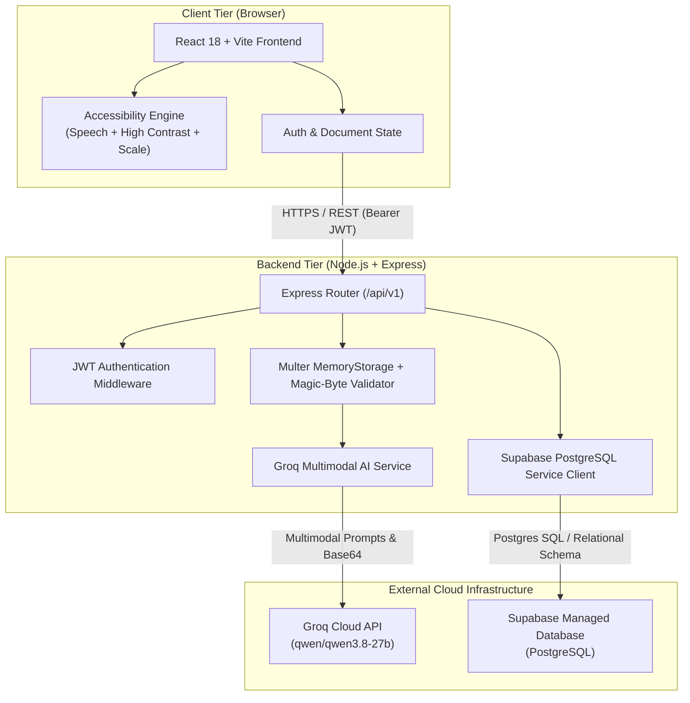
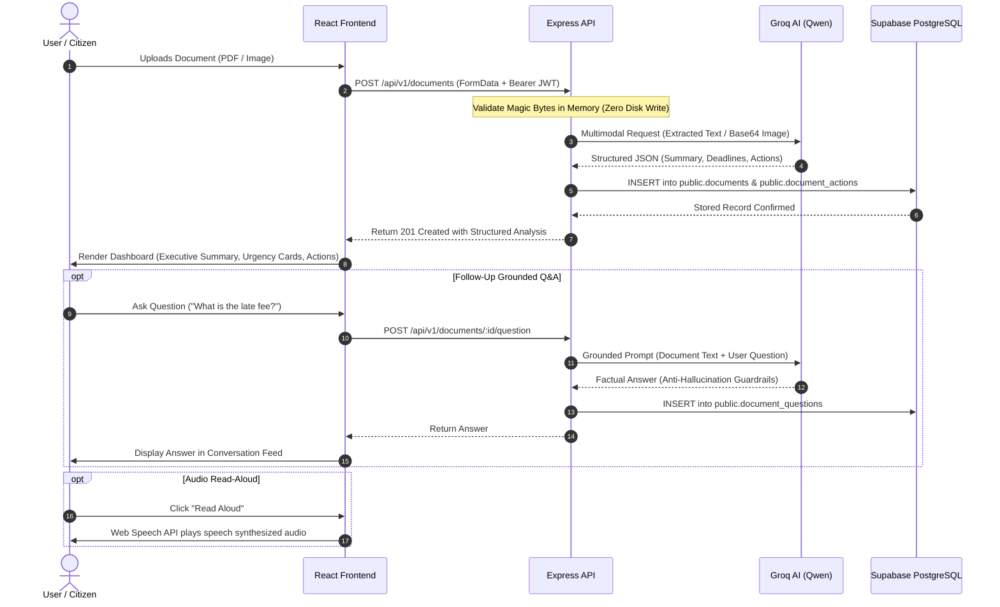

# ClearDoc

> **Complex Documents. Clear Understanding.**

[](https://www.typescriptlang.org/)
[](https://react.dev/)
[](https://nodejs.org/)
[](https://expressjs.com/)
[](https://tailwindcss.com/)
[](https://supabase.com/)
[](https://groq.com/)
[](./LICENSE)

---

## 1. Project Overview

**ClearDoc** is an AI-powered accessibility platform engineered to transform dense, confusing, and stressful paperwork into simple, plain-English explanations. 

Whether it is an electricity bill with punitive late-fee clauses, a hospital discharge summary packed with clinical jargon, a government tax assessment, or a legal summons, ClearDoc demystifies the fine print. Built with universal design principles at its core, ClearDoc empowers citizens, elderly users, individuals with cognitive challenges, and non-native speakers to understand what they are reading, identify critical deadlines, and take timely action.

---

## 2. Problem Statement

Every year, millions of citizens suffer financial penalties, missed medical instructions, and legal defaults simply because everyday paperwork is written in inaccessible, bureaucratic language.

* **Convoluted Billing**: Utility and telecom invoices conceal disconnection dates, tiered tariff jumps, and compounding late fees across multiple footnotes.
* **Intimidating Healthcare Documentation**: Discharge summaries, lab reports, and prescription instructions frequently use clinical shorthand that patients cannot interpret at home.
* **Civic & Legal Barriers**: Tax notices, tenancy agreements, and municipal letters use archaic phrasing that discourages compliance and induces panic.
* **Accessibility Exclusion**: Individuals with dyslexia, low literacy, visual impairments, or cognitive fatigue face severe friction navigating traditional documents without assistance.

---

## 3. Our Solution

ClearDoc provides an instant, privacy-conscious bridge between bureaucratic paperwork and human understanding.

1. **Upload & In-Memory Analysis**: Users upload digital documents (PDF, PNG, JPEG, WebP). Files are processed entirely in server memory without saving raw files to persistent disk.
2. **Multimodal AI Comprehension**: Powered by the Groq Cloud multimodal engine (`qwen/qwen3.8-27b`), ClearDoc reads both visual typography and extracted document text to produce structured, factual analyses.
3. **Action-Oriented Dashboard**: Documents are broken down into three instant takeaways:
   * **Simple Summary**: Plain-English explanation written at a Grade 6 reading level.
   * **Deadlines & Urgency**: Extracted dates, amounts owed, and consequences of inaction highlighted in alert banners.
   * **Action Checklist**: Concrete, step-by-step instructions (e.g., *"Pay \$42.50 before Nov 15 via municipal portal"*).
4. **Universal Accessibility Suite**: Native browser speech synthesis (read aloud), WCAG AAA high-contrast theme toggle, and dynamic font scaling.
5. **Grounded Follow-Up Q&A**: An interactive chat assistant strictly constrained to the uploaded document to answer questions without hallucination.

---

## 4. Key Features

| Feature | Description |
| :--- | :--- |
| **Plain-English Simplification** | Translates complex legal, medical, and financial terminology into plain, everyday English. |
| **Deadline & Fee Extraction** | Detects due dates, cutoff windows, late penalties, and account numbers automatically. |
| **Action Item Checklist** | Generates an interactive checklist of required actions with priority indicators. |
| **Audio Read-Aloud** | Integrates browser-native Web Speech synthesis with play, pause, stop, and rate adjustment (0.75x–1.5x). |
| **Grounded Document Q&A** | Allows users to ask follow-up questions strictly answered using the document's verified contents. |
| **Privacy-First In-Memory Ingestion** | Uses `Multer.memoryStorage()` so raw user files are processed in ephemeral RAM and never written to disk. |
| **WCAG AAA High Contrast** | Instant high-contrast mode switching to deep navy, stark black, and crisp white borders. |
| **Dynamic Font Scaling** | Toggle between Normal (100%), Large (112.5%), and Extra Large (125%) without layout breakage. |
| **Magic-Byte Validation** | Verifies true file signatures before processing to prevent malicious MIME spoofing. |
| **Document History Archive** | View previously analyzed documents, review key findings, or delete records on demand. |

---

## 5. Technology Stack

### Frontend Application (`apps/frontend`)
* **Framework**: React 18 with TypeScript
* **Build Tool**: Vite 5
* **Styling**: Tailwind CSS with custom editorial design system tokens
* **Icons**: Lucide React
* **HTTP Client**: Axios with centralized error and auth interceptors
* **Routing**: React Router DOM v6
* **Speech Engine**: Web Speech Synthesis API (`window.speechSynthesis`)

### Backend API Service (`apps/backend`)
* **Runtime**: Node.js 18+ with Express.js
* **Language**: TypeScript (compiled via `tsc`)
* **File Handling**: Multer (configured with `MemoryStorage`)
* **PDF Extraction**: `pdf-parse` (in-memory buffer parsing)
* **Security & Auth**: Custom Express JWT (`jsonwebtoken`) and `bcryptjs` (12 salt rounds)
* **MIME Validation**: Buffer magic-byte inspection (PDF, PNG, JPEG, WebP)

### Database & Cloud Services
* **Database**: Supabase PostgreSQL (`public.users`, `public.documents`, `public.document_questions`, `public.document_actions`)
* **AI Provider**: Groq Cloud API (`qwen/qwen3.8-27b` multimodal model)
* **Client SDK**: `@supabase/supabase-js` (backend service-role client for isolated data operations)

---

## 6. Architecture Overview

ClearDoc is designed as a decoupled, monorepo architecture. The frontend communicates with the backend exclusively through a versioned REST API (`/api/v1`). The backend isolates database queries and third-party AI inferences, guaranteeing that credentials and raw file buffers never leak to client browsers.



---

## 7. Application Workflow

When a user submits a document, ClearDoc executes a secure, multi-stage processing pipeline:



---

## 8. UI & Experience Preview

The user experience prioritizes visual clarity, generous contrast, and rapid information discovery. Below are wireframe representations of the primary user interfaces:

### Document Upload & Ingestion
```text
+--------------------------------------------------------------------------+
|  ClearDoc                    [ A11y: High Contrast | Text Size ]  (Logout)|
+--------------------------------------------------------------------------+
|                                                                          |
|       Simplify Your Paperwork In Seconds                                |
|       Upload bills, medical reports, civic notices, or legal letters.     |
|                                                                          |
|       + - - - - - - - - - - - - - - - - - - - - - - - - - - - - - - +    |
|       |                     [ Upload Icon ]                         |    |
|       |       Drag & drop your document here, or Browse File        |    |
|       |       Supports PDF, PNG, JPG, WebP up to 10MB               |    |
|       + - - - - - - - - - - - - - - - - - - - - - - - - - - - - - - +    |
|                                                                          |
|       [ In-Memory Privacy ]  [ Zero Disk Retention ]  [ Fast AI Output ] |
+--------------------------------------------------------------------------+
```

### Document Explanation Dashboard
```text
+--------------------------------------------------------------------------+
|  <- Back to Documents          Electricity_Bill_March.pdf     [Download] |
+--------------------------------------------------------------------------+
|  [ SUMMARY CARD ]                                                        |
|  This is an overdue electricity bill from City Electric Services.       |
|  A disconnection warning has been issued due to an unpaid prior balance. |
|  [ Read Aloud Play Button ]  [ Speed: 1.0x ]                             |
+--------------------------------------------------------------------------+
|  [ URGENT DEADLINES & FINANCIALS ]                                       |
|  * Due Date: March 15, 2026 (URGENT - 3 Days Left)                       |
|  * Total Amount Due: $142.80                                             |
|  * Penalty: $15.00 late fee applied if not paid by due date              |
+--------------------------------------------------------------------------+
|  [ ACTION CHECKLIST ]                                                    |
|  [ ] 1. Pay $142.80 via online portal at www.cityelectric.gov/pay        |
|  [ ] 2. Reference Account Number: #9832-1104-01                          |
|  [ ] 3. Call customer service (1-800-555-0199) if financial aid needed   |
+--------------------------------------------------------------------------+
|  [ GROUNDED DOCUMENT Q&A ]                                               |
|  User: "Can I pay in installments?"                                      |
|  ClearDoc: "Yes. Section 3 notes that customers can request a 30-day     |
|             installment plan by calling customer care before March 12."   |
|  [ Ask a question about this document...                       ] [ Send ]|
+--------------------------------------------------------------------------+
```

---

## 9. Project Structure

ClearDoc is organized as a clean npm monorepo with workspace isolation:

```text
Buld2Ship/
├── apps/
│   ├── backend/                      # Node.js + Express API Service
│   │   ├── src/
│   │   │   ├── config/               # Environment & Supabase client config
│   │   │   ├── controllers/          # Auth & Document request handlers
│   │   │   ├── middleware/           # JWT auth, Multer memory storage, error handling
│   │   │   ├── routes/               # /api/v1/auth & /api/v1/documents endpoints
│   │   │   ├── services/             # Groq AI multimodal integration & prompt engine
│   │   │   └── types/                # TypeScript interface definitions
│   │   ├── package.json
│   │   └── tsconfig.json
│   │
│   └── frontend/                     # React + Vite Client Application
│       ├── src/
│       │   ├── components/           # Navbar, Dropzone, Accessibility controls, Modals
│       │   ├── context/              # AuthContext & AccessibilityContext providers
│       │   ├── hooks/                # useSpeechSynthesis, useDocumentAnalysis
│       │   ├── pages/                # Landing, Login, Register, Dashboard, DocDetail
│       │   ├── services/             # Axios API client with interceptors
│       │   ├── types/                # Frontend TypeScript models
│       │   ├── App.tsx               # Route declarations & global layout
│       │   ├── index.css             # Tailwind base styles & accessibility themes
│       │   └── main.tsx              # DOM root mount
│       ├── package.json
│       ├── tailwind.config.js        # Design tokens & color system
│       └── vite.config.ts            # Vite proxy & build settings
│
├── docs/                             # Comprehensive Architecture & Engineering Docs
│   ├── ARCHITECTURE.md               # Deep-dive system architecture & security model
│   ├── TECH-STACK.md                 # Complete technology catalog and rationale
│   ├── PROJECT-SETUP.md              # Installation guide & troubleshooting checklist
│   ├── DEVELOPMENT-JOURNEY.md        # Chronological engineering log (Step 01 - 12)
│   ├── FEATURES.md                   # Full feature specifications & status matrix
│   ├── DATABASE.md                   # Supabase PostgreSQL relational schema & indexes
│   ├── API-DOCUMENTATION.md          # REST API endpoints, schemas & status codes
│   └── prompts/                      # Complete AI prompt archive
│       ├── PROJECT-PLANNING.md       # Scoping, accessibility & privacy prompts
│       ├── UI-UX-DESIGN.md           # Visual design tokens & a11y specifications
│       ├── DEVELOPMENT-PROMPTS.md    # API pipelines, Groq prompts & grounded Q&A
│       └── TESTING-PROMPTS.md        # Debugging protocols & smoke verification
│
├── supabase/
│   └── migrations/                   # Production PostgreSQL database migrations
│       └── 20261030000000_init_cleardoc.sql
│
├── .env.example                      # Sanitized environment template
├── .gitignore                        # Git exclusion rules (zero secret commits)
├── LICENSE                           # MIT License
├── package.json                      # Monorepo workspaces manifest
└── README.md                         # Project documentation root
```

---

## 10. Installation Instructions

### Prerequisites
* **Node.js**: `v18.0.0` or higher
* **npm**: `v9.0.0` or higher (or `pnpm` / `yarn`)
* **Supabase Project**: Free tier PostgreSQL database
* **Groq Cloud API Key**: For multimodal AI inference ([console.groq.com](https://console.groq.com))

### 1. Clone the Repository
```bash
git clone https://github.com/tholkappiyan2008/LucidDocs_S.git
cd LucidDocs_S
```

### 2. Install Dependencies
Install all workspace dependencies from the root directory:
```bash
npm install
```

### 3. Initialize Database
Execute the database migration SQL in your Supabase SQL Editor:
1. Open your Supabase Dashboard -> **SQL Editor**.
2. Paste and run the contents of [`supabase/migrations/20261030000000_init_cleardoc.sql`](./supabase/migrations/20261030000000_init_cleardoc.sql).
3. Confirm that tables `users`, `documents`, `document_questions`, and `document_actions` are created.

---

## 11. Environment Configuration

Copy the template file to `.env` in the project root:
```bash
cp .env.example .env
```

Configure your environment variables as shown below:

```ini
# ==============================================================================
# ClearDoc Configuration File (.env)
# ==============================================================================

# Server Network Configuration
PORT=5000
NODE_ENV=development
API_PREFIX=/api/v1

# Supabase PostgreSQL Configuration (Backend Service Client Only)
# Found under: Supabase Dashboard -> Project Settings -> API
SUPABASE_URL=https://your-project-id.supabase.co
SUPABASE_SERVICE_ROLE_KEY=your-supabase-service-role-secret-key

# Groq Cloud Multimodal AI Configuration
# Found under: https://console.groq.com/keys
GROQ_API_KEY=gsk_your_groq_api_key_here
GROQ_MODEL=qwen/qwen3.8-27b

# Authentication Secrets
# Generate using: openssl rand -base64 32
JWT_SECRET=your-secure-random-jwt-secret-string-min-32-chars
JWT_EXPIRES_IN=7d

# Frontend Application Configuration
VITE_API_URL=http://localhost:5000/api/v1
```

> [!IMPORTANT]
> Never commit actual credentials to Git. ClearDoc's `.gitignore` automatically blocks `.env` and `.env.local` files.

---

## 12. Running Locally

You can run both backend and frontend concurrently from the root directory:

```bash
# Start backend (port 5000) and frontend (port 5173) concurrently
npm run dev
```

Alternatively, start services individually in separate terminals:

```bash
# Terminal 1: Backend API Service
npm run dev:backend
# API will start at: http://localhost:5000/api/v1
# Health endpoint:   http://localhost:5000/api/v1/health

# Terminal 2: Frontend Web Application
npm run dev:frontend
# Client will start at: http://localhost:5173
```

---

## 13. Documentation Index

Detailed engineering documentation is available in the [`docs/`](./docs) directory:

| Document | Focus Area |
| :--- | :--- |
| **[Architecture Guide](./docs/ARCHITECTURE.md)** | System topology, data flow sequence diagrams, and security model. |
| **[Tech Stack Catalog](./docs/TECH-STACK.md)** | Technical dependencies, package versions, and selection rationale. |
| **[Project Setup Guide](./docs/PROJECT-SETUP.md)** | Step-by-step developer onboarding and deployment readiness. |
| **[Development Journey](./docs/DEVELOPMENT-JOURNEY.md)** | Chronological log of architecture, refactoring, and milestones. |
| **[Features & Roadmap](./docs/FEATURES.md)** | Feature status matrix for V1 release and planned V2 milestones. |
| **[Database Schema](./docs/DATABASE.md)** | Supabase PostgreSQL tables, foreign keys, constraints, and indexes. |
| **[API Documentation](./docs/API-DOCUMENTATION.md)** | Full REST endpoint reference, JSON payloads, and response status codes. |
| **[AI Prompt Archive](./docs/prompts/)** | Prompts used for planning, UX design, backend development, and testing. |

---

## 14. Quality & Build Verification

To verify code quality and build production assets across all workspaces:

```bash
# Check TypeScript types in frontend and backend
npm run type-check

# Compile production backend build
npm run build:backend

# Compile production frontend build (Vite + PostCSS)
npm run build:frontend
```

---

## 15. Future Improvements (V2 Roadmap)

* [ ] **Multilingual Accessibility**: Support for regional Indian languages (Tamil, Telugu, Hindi) for summaries, action items, and text-to-speech.
* [ ] **Multi-Page Pagination**: Advanced batching and thumbnail navigation for large multi-page legal contracts and court filings.
* [ ] **SMS & WhatsApp Reminders**: Direct webhook dispatch to notify users 48 hours and 24 hours prior to identified payment or filing deadlines.
* [ ] **Voice-Driven Follow-Up**: Direct microphone input for asking questions verbally using browser Speech-to-Text (`SpeechRecognition`).
* [ ] **Exportable Summaries**: One-click generation of simplified PDF/print takeaways to take to doctor visits or municipal offices.

---

## 16. Security & Privacy

ClearDoc handles sensitive personal documentation with strict defensive standards:
* **In-Memory Buffering**: Uploads are held in RAM via `multer.memoryStorage()` during inference and released immediately upon response generation.
* **MIME Verification**: Binary magic bytes (`%PDF-`, `\x89PNG`, `\xFF\xD8\xFF`, `RIFF`) are checked to prevent malicious file uploads.
* **Grounded AI Guardrails**: The Q&A model is restricted to facts extracted directly from the user's document to eliminate hallucinated advice.
* **Relational Isolation**: User document records and action items are linked to authenticated `user_id` foreign keys with cascade deletion.

---

## 17. License

This project is licensed under the **MIT License**. See the [`LICENSE`](./LICENSE) file for complete terms and copyright details.

---

**Built with pride to make complex paperwork accessible to everyone.**
