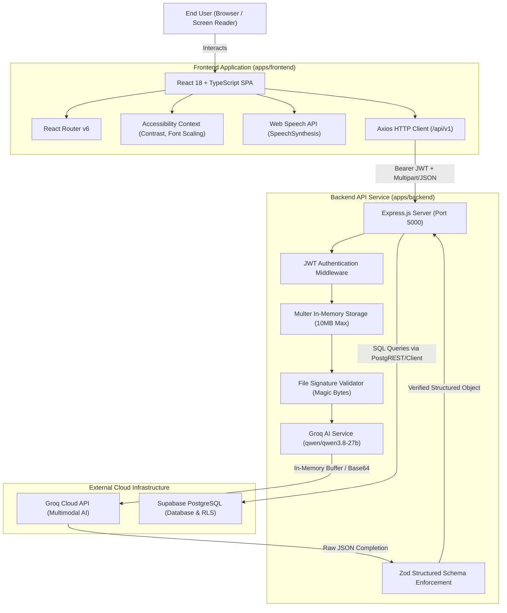
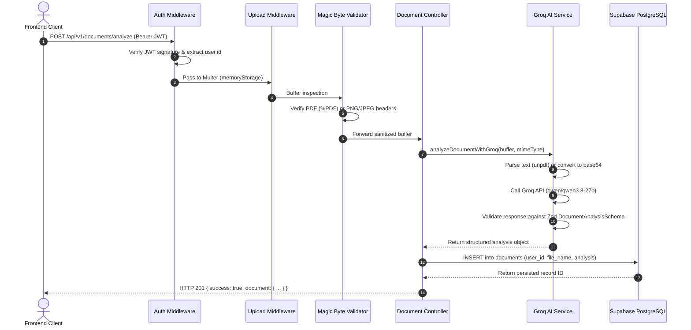
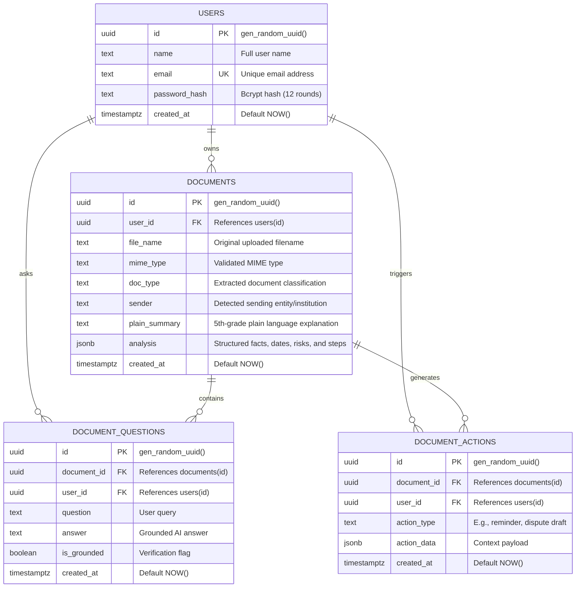

# ClearDoc System Architecture

ClearDoc is an AI-powered document accessibility platform built to transform complex paperwork—such as utility bills, medical discharge summaries, legal notices, and bank statements—into plain, accessible language with verified metrics, actionable deadlines, risk flags, and voice read-aloud capabilities.

---

## 1. High-Level Architecture Overview

ClearDoc follows a decoupled client-server architecture built as an npm workspace monorepo:



---

## 2. Frontend Architecture (`apps/frontend`)

The frontend is a single-page application (SPA) created with **React 18**, **Vite**, and **TypeScript**, styled via **Tailwind CSS** and animated with **Motion** and **Lenis**.

```
apps/frontend/src/
├── components/          # Reusable UI & accessibility modules
│   ├── AudioPlayer.tsx  # Web Speech API read-aloud controller
│   ├── DocumentQA.tsx   # Context-grounded follow-up Q&A thread
│   ├── Footer.tsx       # Standardized brand footer & quick settings
│   ├── Logo.tsx         # ClearDoc responsive monogram & wordmark
│   ├── Navbar.tsx       # Navigation bar with A11y quick-toggles
│   ├── ProtectedRoute.tsx # Route-guard checking valid JWT token
│   ├── Reveal.tsx       # Motion-based staggered entrance animation
│   └── SmoothScroll.tsx # Lenis smooth-scrolling wrapper
├── context/
│   ├── A11yContext.tsx  # High-contrast and font-size state
│   └── AuthContext.tsx  # Authentication session, tokens, user profile
├── hooks/
│   └── useSpeechSynthesis.ts # Browser Web Speech hook with rate/voice control
├── lib/
│   └── scroll.ts        # Motion detection and anchor scrolling
├── pages/
│   ├── DashboardPage.tsx    # Document workspace, upload prompt, history list
│   ├── DocumentDetailPage.tsx # Editorial results view, facts, deadlines, Q&A
│   ├── HistoryPage.tsx      # Paginated document archive with delete modal
│   ├── LandingPage.tsx      # Editorial product landing page & trust badges
│   ├── LoginPage.tsx        # Authentication sign-in with password toggle
│   ├── RegisterPage.tsx     # New account onboarding form
│   └── UploadPage.tsx       # Drag-and-drop zone with in-memory validation
├── services/
│   ├── api.ts              # Axios instance configured with JWT interceptors
│   ├── auth.service.ts     # Login, registration, and session restore
│   └── document.service.ts # Upload, fetch, delete, translate, ask API calls
└── index.css               # Design tokens, @fontsource/manrope, WCAG high contrast
```

### State Management & Communication
1. **Authentication State (`AuthContext`)**: Stores the JWT token in `localStorage`, decodes the session, and attaches the `Authorization: Bearer <token>` header to all outgoing requests via Axios interceptors.
2. **Accessibility State (`A11yContext`)**: Manages the `high-contrast` mode (WCAG AAA yellow-on-black) and `large-text` mode (118% dynamic rem scaling), persisting preferences across sessions.
3. **Route Protection**: The `<ProtectedRoute>` component intercepts navigation to `/dashboard`, `/upload`, `/history`, and `/documents/:id`, redirecting unauthenticated users to `/login`.

---

## 3. Backend Architecture (`apps/backend`)

The backend is a RESTful API powered by **Node.js**, **Express.js**, and **TypeScript**.

```
apps/backend/src/
├── config/
│   ├── env.ts              # Strongly-typed environment variables via dotenv
│   └── supabase.ts         # Supabase PostgreSQL client (service role)
├── controllers/
│   ├── auth.controller.ts     # User registration, login, and profile
│   └── document.controller.ts # Document analysis, CRUD, Q&A, and translations
├── middleware/
│   ├── auth.middleware.ts   # JWT verification and user extraction
│   ├── error.middleware.ts  # Centralized error handler with standardized JSON
│   └── upload.middleware.ts # Multer memory-storage (10MB limit, file filter)
├── routes/
│   ├── auth.routes.ts       # /api/v1/auth routes
│   └── document.routes.ts   # /api/v1/documents routes
├── services/
│   └── groq.service.ts      # Groq AI multimodal extraction and chat completion
├── utils/
│   └── file-validator.ts    # Magic-byte file header validation
├── validators/
│   ├── auth.validator.ts     # Zod schemas for login and registration
│   ├── document.validator.ts # Zod schema enforcing document analysis shape
│   └── question.validator.ts # Zod schema for follow-up questions
└── server.ts                 # Express initialization, CORS, and port listening
```

### Request Flow Lifecycle



---

## 4. Database Architecture (Supabase PostgreSQL)

All relational data is stored in **Supabase PostgreSQL**. The schema enforces strict multi-tenant ownership isolation through Foreign Key constraints and `ON DELETE CASCADE`.



---

## 5. Security & Privacy Architecture

1. **Zero Raw Disk Storage**: Uploaded PDF and image files are processed strictly within temporary Node.js `Buffer` objects in volatile memory. Files are never written to the host filesystem.
2. **Magic-Byte File Integrity**: In addition to client-side MIME checks, the backend validates binary magic bytes (`%PDF-`, `PNG \x89PNG`, `JPEG \xFF\xD8\xFF`) to prevent extension spoofing.
3. **Multi-User Ownership Isolation**: Every database query on `/documents` and `/documents/:id/ask` filters strictly by `WHERE user_id = req.user.id`. Users cannot view, query, or delete documents owned by other accounts.
4. **Credential Segregation**: The frontend client never has access to the Supabase Secret Key or Groq API credentials. All third-party communication routes through the backend.
