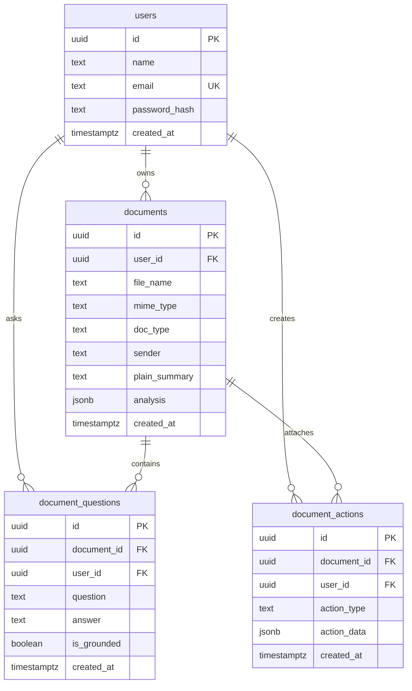

# ClearDoc Database Architecture & Schema

ClearDoc uses **Supabase PostgreSQL** as its relational database. This document details the database schema, table structures, column definitions, relationships, indexes, and security policies.

---

## 1. Schema Architecture Overview

The database uses a relational design centered on multi-tenant user isolation. Every persisted resource (documents, questions, actions) is tied directly to a specific user via Foreign Keys with `ON DELETE CASCADE`.



---

## 2. Table Specifications

### 2.1. `users` Table
Stores user accounts for authentication and data ownership.

| Column | Data Type | Constraints | Description |
|---|---|---|---|
| `id` | `UUID` | `PRIMARY KEY`, Default `gen_random_uuid()` | Unique user identifier. |
| `name` | `TEXT` | `NOT NULL` | Full name of the user. |
| `email` | `TEXT` | `UNIQUE`, `NOT NULL` | Login email address. |
| `password_hash` | `TEXT` | `NOT NULL` | Salted Bcrypt password hash (12 rounds). |
| `created_at` | `TIMESTAMPTZ` | `NOT NULL`, Default `NOW()` | Timestamp when account was created. |

**Indexes**:
- `idx_users_email`: B-tree index on `users(email)` for sub-millisecond authentication lookups.

---

### 2.2. `documents` Table
Stores analyzed document metadata and the structured AI output.

| Column | Data Type | Constraints | Description |
|---|---|---|---|
| `id` | `UUID` | `PRIMARY KEY`, Default `gen_random_uuid()` | Unique document record identifier. |
| `user_id` | `UUID` | `NOT NULL`, `REFERENCES users(id) ON DELETE CASCADE` | Owner user ID. |
| `file_name` | `TEXT` | `NOT NULL` | Original filename of the uploaded file. |
| `mime_type` | `TEXT` | `NOT NULL` | Validated MIME type (`application/pdf`, `image/png`, `image/jpeg`). |
| `doc_type` | `TEXT` | `NOT NULL`, Default `'General Document'` | Document classification (e.g. Utility Bill, Medical Report). |
| `sender` | `TEXT` | `NOT NULL`, Default `'Unknown'` | Sending institution or billing entity. |
| `plain_summary` | `TEXT` | `NOT NULL` | 5th-grade plain-language document summary. |
| `analysis` | `JSONB` | `NOT NULL` | Complete structured payload (key facts, deadlines, risks, steps). |
| `created_at` | `TIMESTAMPTZ` | `NOT NULL`, Default `NOW()` | Timestamp when document was analyzed. |

**JSONB Structure of `analysis`**:
```json
{
  "doc_type": "Electricity Bill",
  "sender": "State Power Distribution",
  "plain_summary": "Your electricity bill for June is ₹2,740...",
  "key_facts": [
    { "label": "Amount Due", "value": "₹2,740", "confidence": 0.98 },
    { "label": "Units Consumed", "value": "342 kWh", "confidence": 0.95 }
  ],
  "deadlines": [
    { "what": "Due Date without surcharge", "date": "15 July 2026" }
  ],
  "risks": [
    { "level": "medium", "note": "Late payment penalty of ₹150 applies after 15 July." }
  ],
  "needs_human_check": [],
  "next_steps": [
    "Pay ₹2,740 before 15 July to avoid penalty fees.",
    "Verify meter reading matches physical meter display."
  ]
}
```

**Indexes**:
- `idx_documents_user_id_created`: Composite B-tree index on `documents(user_id, created_at DESC)` for paginated history retrieval.

---

### 2.3. `document_questions` Table
Stores conversation history for grounded follow-up Q&A.

| Column | Data Type | Constraints | Description |
|---|---|---|---|
| `id` | `UUID` | `PRIMARY KEY`, Default `gen_random_uuid()` | Unique question record identifier. |
| `document_id` | `UUID` | `NOT NULL`, `REFERENCES documents(id) ON DELETE CASCADE` | Associated document ID. |
| `user_id` | `UUID` | `NOT NULL`, `REFERENCES users(id) ON DELETE CASCADE` | Owner user ID. |
| `question` | `TEXT` | `NOT NULL` | User's question string. |
| `answer` | `TEXT` | `NOT NULL` | AI response string grounded in the document. |
| `is_grounded` | `BOOLEAN` | `NOT NULL`, Default `TRUE` | Verification status flag. |
| `created_at` | `TIMESTAMPTZ` | `NOT NULL`, Default `NOW()` | Timestamp when question was answered. |

**Indexes**:
- `idx_questions_document_id`: B-tree index on `document_questions(document_id, created_at ASC)`.

---

### 2.4. `document_actions` Table
Stores action-oriented features such as draft dispute replies or calendar reminders.

| Column | Data Type | Constraints | Description |
|---|---|---|---|
| `id` | `UUID` | `PRIMARY KEY`, Default `gen_random_uuid()` | Unique action identifier. |
| `document_id` | `UUID` | `NOT NULL`, `REFERENCES documents(id) ON DELETE CASCADE` | Associated document ID. |
| `user_id` | `UUID` | `NOT NULL`, `REFERENCES users(id) ON DELETE CASCADE` | Owner user ID. |
| `action_type` | `TEXT` | `NOT NULL` | Type of action (e.g. `reminder_ics`, `dispute_draft`). |
| `action_data` | `JSONB` | `NOT NULL` | Contextual action payload. |
| `created_at` | `TIMESTAMPTZ` | `NOT NULL`, Default `NOW()` | Timestamp when action was generated. |

**Indexes**:
- `idx_actions_document_id`: B-tree index on `document_actions(document_id)`.

---

## 3. Database Migration

The schema is created and managed through standard SQL migrations:

* **File Location**: `supabase/migrations/20261030000000_init_cleardoc.sql`
* **Extensions Enabled**:
  ```sql
  CREATE EXTENSION IF NOT EXISTS "pgcrypto";
  ```
* **Execution**: Can be run via the Supabase SQL Editor or Supabase CLI (`supabase db push`).

---

## 4. Multi-Tenant Security & Ownership Enforcement

1. **Foreign Key Cascade Protection**: All child records in `documents`, `document_questions`, and `document_actions` cascade automatically upon parent deletion. Deleting a user or document leaves zero orphaned records.
2. **Backend Application-Level Filtering**: Every query executed in `document.controller.ts` includes `eq('user_id', req.user.id)` to guarantee that accounts cannot read or manipulate documents belonging to other users.
3. **Database Permissions**:
   ```sql
   GRANT ALL ON TABLE users, documents, document_questions, document_actions 
   TO postgres, service_role, authenticated, anon;
   ```
   All direct database queries are routed through the backend using the Supabase `service_role` key, preventing direct client exposure.
